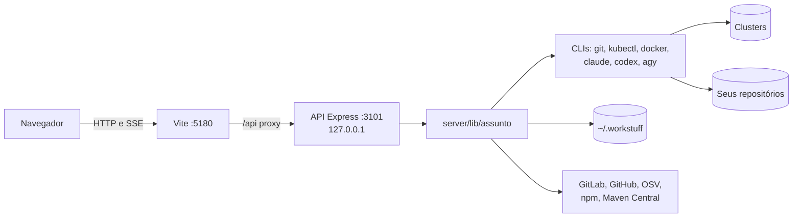
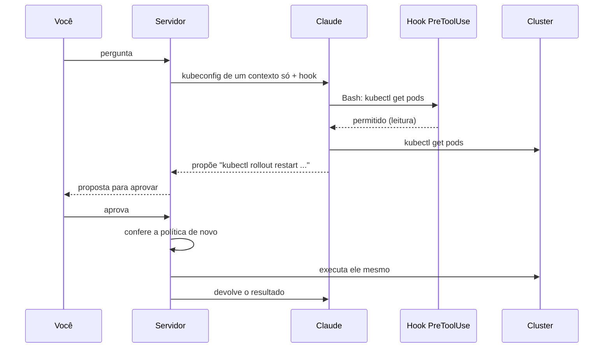

# Arquitetura do workStuff

O workStuff é um painel web local, de uma pessoa só, para o trabalho diário de desenvolvimento e DevOps. Ele confere se a máquina está pronta, clona repositórios, acompanha pipelines, inspeciona clusters Kubernetes, roda agentes de IA em modo leitura sobre código e clusters e, na [Fábrica](fabrica.md), conduz agentes que escrevem código numa cópia isolada do repositório.

Tudo roda na sua máquina: a API escuta só em `127.0.0.1`, os dados ficam em `~/.workstuff` e o trabalho pesado é feito pelos CLIs que você já tem instalados (`git`, `kubectl`, `claude`, `codex`, `agy`, `docker`).

O [README](../README.md) traz a lista de telas, os requisitos e como subir o projeto. Este documento explica como as peças se encaixam.

## Sumário

1. [Visão geral](#1-visão-geral)
2. [Processos e portas](#2-processos-e-portas)
3. [Servidor](#3-servidor)
4. [Camada de IA](#4-camada-de-ia)
5. [Kubernetes e a política de ambientes](#5-kubernetes-e-a-política-de-ambientes)
6. [Cluster Doctor](#6-cluster-doctor)
7. [Módulos por funcionalidade](#7-módulos-por-funcionalidade)
8. [Frontend](#8-frontend)
9. [Dados](#9-dados)
10. [Modelo de segurança](#10-modelo-de-segurança)
11. [Testes](#11-testes)
12. [Convenções](#12-convenções)

---

## 1. Visão geral



Duas peças, uma por processo:

- **Frontend** (`src/`): React 18, React Router 7 e Vite, em português.
- **Servidor** (`server/`): Express 5 em TypeScript executado direto pelo Node, sem etapa de build (*type stripping*).

O código é organizado por assunto. Cada tela tem uma pasta em `src/features/<assunto>/`, um router em `server/routes/<assunto>.ts` e, na maioria dos casos, a lógica em `server/lib/<assunto>/`. A rota cuida de HTTP; a lógica fica em `lib`.

## 2. Processos e portas

| Comando | O que sobe |
|---|---|
| `npm run dev` | API (`node --watch server/index.ts`) e Vite juntos, via `concurrently`. |
| `npm run server` | Só a API. |
| `npm run client` | Só o Vite. |
| `npm run build` | Typecheck do frontend e do servidor, depois o build do Vite em `dist/`. |

- **Web**: Vite na porta **5180** (`strictPort`), com proxy de `/api` para a API (`vite.config.ts`).
- **API**: porta `PORT`, padrão **3101**, escutando só em `127.0.0.1` (`server/index.ts`).
- As portas fogem das padrões (5173/3001) para conviver com outros projetos.

Para testar sem tocar nos seus dados, aponte `WORKSTUFF_HOME`, `WORKSTUFF_KUBE_DIR` e `WORKSTUFF_AGENT_HOME` para pastas temporárias e use outra `PORT` (o proxy do Vite segue a variável).

## 3. Servidor

### 3.1 Inicialização (`server/index.ts`)

- `express.json({ limit: '1mb' })`.
- Um router por assunto, montado em `/api/<assunto>`:

| Prefixo | Router | Prefixo | Router |
|---|---|---|---|
| `/api/settings` | `settings.ts` | `/api/upgrade` | `upgrade.ts` |
| `/api/ai/providers` | `aiProviders.ts` | `/api/compare` | `compare.ts` |
| `/api/catalog` | `catalog.ts` | `/api/incident` | `incident.ts` |
| `/api/doctor` | `doctor.ts` | `/api/review` | `review.ts` |
| `/api/k8s` | `k8s.ts` | `/api/profile` | `profile.ts` |
| `/api/cluster-doctor` | `clusterDoctor.ts` | `/api/local` | `local.ts` |
| `/api/analysis` | `analysis.ts` | `/api/schedules` | `schedules.ts` |
| `/api/resources` | `resources.ts` | `/api/runbooks` | `runbooks.ts` |
| `/api/repos` | `repos.ts` | `/api/playbooks` | `playbooks.ts` |
| `/api/performance` | `performance.ts` | `/api/dev-runbooks` | `devRunbooks.ts` |
| `/api/pipelines` | `pipelines.ts` | `/api/factory` | `factory.ts` |
| `/api/vulns` | `vulns.ts` | `/api/status` | `status.ts` |

- Caminho `/api` desconhecido responde 404 em JSON; erro não tratado responde 500 genérico, com o detalhe só no log.
- **Ao subir**: o agendador de verificações começa (primeiro ciclo após 10 s, depois a cada 60 s, uma verificação por vez), e as observações de performance que estavam rodando são retomadas.

### 3.2 Infraestrutura compartilhada (`server/lib/*.ts`)

| Arquivo | Para quê |
|---|---|
| `run.ts` | `run(bin, args)` via `execFile`, sem shell, com timeout; `which(bin)`; `runHelp` para CLIs que imprimem ajuda no stderr. |
| `sse.ts` | `openSse(res)`: `{ signal, send, end }`. Fechar a conexão aborta o `signal`. |
| `paths.ts` | `DATA_DIR` (`WORKSTUFF_HOME` ou `~/.workstuff`), `dataFile`, `AGENT_HOME`, pastas padrão de runbooks e playbooks, `expandHome`, `tildify`. |
| `jsonFile.ts` | `readJson` com valor padrão; `writeJson` atômico (arquivo temporário e `rename`). |
| `settingsStore.ts` | Provedor, modelo e esforço de IA (`settings.json`), validados porque viram argumento de CLI. |
| `aiProviders.ts`, `aiModels.ts` | Metadados de cada CLI de IA e leitura da lista de modelos de cada um, com cache. |
| `platform.ts` | Sistema e distribuição; comando de instalação sugerido por gerenciador (apt, dnf, pacman, brew, winget). |
| `desktop.ts` | Abrir no editor (`WORKSTUFF_EDITOR` ou `code`) e seletor de pasta nativo. |
| `concurrency.ts` | `mapLimit`: paralelismo limitado mantendo a ordem. |

### 3.3 Streams

Ações longas (IA, clone, diagnóstico) respondem como **SSE**: cada evento é uma linha `data: <json>`. O frontend consome de duas formas:

- `streamPost` (`src/lib/stream.ts`): POST com corpo, lendo a resposta como stream. Usado quando a ação tem parâmetros.
- `EventSource`: GET, reconecta sozinho. Usado em logs, performance e no acompanhamento ao vivo da Fábrica.

Na maior parte do painel, fechar o stream aborta a execução. A Fábrica é a exceção: as execuções dela vivem no servidor e fechar a tela só para de assistir.

## 4. Camada de IA

`server/lib/ai/` executa os CLIs de IA para todas as telas que usam IA (Análise, Revisão, Pipelines, Incidente, Performance, Playbooks, Catálogo, Cluster).

### 4.1 Argumentos em modo leitura (`args.ts`)

| Provedor | Como roda |
|---|---|
| Claude Code | `--output-format stream-json`, `--tools Read Grep Glob`, `--allowedTools Read Grep Glob`, `--strict-mcp-config`. |
| Codex | `exec --json -s read-only --skip-git-repo-check`. |
| Antigravity | Dentro do `bwrap`: disco inteiro somente leitura (`--ro-bind / /`), graváveis só `~/.gemini` e um tmp. Sem `bwrap`, recusa rodar. |

O Antigravity grava em disco mesmo com `--mode plan` e `--sandbox` (verificado), por isso o jail. O selfcheck de `args.ts` garante que nenhum provedor recebe flags de autoaprovação nesse modo.

A Fábrica tem argumentos próprios para os agentes com escrita, sempre presos no `bwrap` ou no sandbox do Codex: veja [fabrica.md, seção 10](fabrica.md#10-segurança-e-isolamento).

### 4.2 Eventos (`events.ts`)

Cada CLI fala um formato de linha diferente. `createParser(provider)` traduz para um formato único:

```ts
type AiEvent =
  | { type: 'text'; text: string }
  | { type: 'thinking'; text: string }
  | { type: 'tool'; id: string; tool: string; input: unknown }
  | { type: 'tool-result'; id: string; tool?: string; isError: boolean; content: string }
  | { type: 'status'; message: string }
  | { type: 'result'; ok: boolean; text: string }
```

O parser também guarda o id da sessão do CLI (para `claude --resume`) e o uso de tokens e custo, quando o CLI informa.

### 4.3 Execução (`runner.ts`)

- `spawn` sem shell.
- Watchdog a cada 2 s: encerra quem passar do limite total (padrão 10 min) ou ficar sem saída (padrão 3 min), com SIGTERM e depois SIGKILL.
- Parada pedida pelo usuário termina como `stopped`, não como erro, e preserva a resposta parcial.
- Falha de autenticação vem com a dica de `claude login` ou `codex login`.

## 5. Kubernetes e a política de ambientes

`server/lib/k8s/`:

- **kubectl**: toda chamada leva `--kubeconfig`, `--context` e `--request-timeout=20s`, sem shell. O erro do stderr é classificado em proibido, não autenticado, não encontrado, inacessível ou outro.
- **Kubeconfigs**: lidos de `WORKSTUFF_KUBE_DIR` (padrão `~/.kube`). A sessão escolhida fica em `cluster-session.json`.
- **Classificação do ambiente** pelo nome (a primeira que casa vence, PRO primeiro), com ajuste manual em `cluster-environments.json`:

| Ambiente | Nomes reconhecidos |
|---|---|
| PRO | `pro`, `prod`, `production`, `prd`, `producao` |
| HML | `hml`, `homolog...`, `staging`, `stg` |
| ITG | `itg`, `integra...`, `integration` |
| DES | `des`, `dev`, `development` |

- **Política de escrita** (`authorizeMutation`, `policy.ts`), aplicada por Cluster, Cluster Doctor e Runbooks:
  - PRO: nunca escreve.
  - Sem classificação: tratado como PRO.
  - Ações em node (cordon, drain, taint): nunca.
  - DES: nunca apaga.
  - O resto passa, sempre depois da sua confirmação.
- **Moldura de ambiente** na interface: nas telas de Kubernetes a janela ganha uma moldura cuja espessura cresce com o risco do cluster conectado (fina para DES, tracejada para ITG, grossa para HML, hachurada para PRO e sem classificação). A diferença vem da forma, não da cor.

## 6. Cluster Doctor

Diagnóstico de cluster por conversa com IA (`server/lib/doctorAi/`, `server/routes/clusterDoctor.ts`). Só roda com Claude Code, o único CLI suportado com gancho nativo de ferramenta.



- **Acesso restrito**: uma pasta temporária (modo 700) com um kubeconfig que só tem o contexto escolhido (`kubectl config view --minify --flatten`, modo 600) e um `settings.json` que instala o gancho.
- **Gancho** (`hook.ts`): confere cada comando antes de rodar. Exatamente uma chamada `kubectl`, sem pipe, encadeamento, redirecionamento ou substituição; flags que trocam o alvo (`--kubeconfig`, `--context`, `--server`, `--token`, `--as`...) recusadas; secrets, `exec`, `cp`, `port-forward`, `create` e `run` sempre recusados.
- **Escrita**: o agente não escreve. Ele propõe o comando num bloco; você aprova ou recusa; na aprovação o servidor confere a política outra vez e executa ele mesmo, sem shell, e devolve o resultado ao agente.
- **Auditoria**: cada tentativa vai para `~/.workstuff/doctor-audit.log`.

## 7. Módulos por funcionalidade

| Tela | Rota | `server/lib/` | Usa | Guarda em `~/.workstuff` |
|---|---|---|---|---|
| Início | `/` | vários | APIs da Fábrica, cluster, máquina e serviços | nada |
| Fábrica | `/fabrica` | `factory` | git, CLIs de IA, bwrap, GitLab/GitHub | `factory/`, `worktrees/` ([fabrica.md](fabrica.md)) |
| Runbooks de dev | `/dev-runbooks` | `devRunbooks` | git, docker, npm e outros binários permitidos | `dev-runbooks.json`, `dev-runbook-audit.log` |
| Conversores | `/conversores` | nenhum | só no navegador | nada |
| Serviços locais | `/servicos` | `local` | `ss`/`netstat`/`lsof`, `docker` | nada |
| Verificações agendadas | `/agenda` | `schedules` | notificação do sistema | `schedules.json`, `schedule-alerts.json` |
| Gerador de dados | `/gerador` | nenhum | só no navegador | nada |
| Máquina | `/maquina` | `doctor` | os CLIs que confere | `doctor-config.json` |
| Perfil de equipe | `/perfil` | `profile` | outros stores | nada próprio |
| Repositórios | `/repositorios` | `repos` | API GitLab/GitHub, `git clone`, `ssh`, `gh` | `repo-sources.json`, `git-credentials.json` (600) |
| Pipelines | `/pipelines` | `pipelines` | GitLab CI, GitHub Actions, IA | `pipelines-watch.json` |
| Revisão antes do MR | `/revisao` | `review` | git, IA | nada |
| Vulnerabilidades | `/vulnerabilidades` | `vulns` | OSV, npm, Maven Central, `trivy` | `vulns-history.json` |
| Cluster | `/cluster` | `k8s`, `doctorAi` | kubectl, IA | `cluster-session.json`, `cluster-environments.json`, `doctor/` |
| Requests & Limits | `/recursos` | `resources` | GitLab, kubectl | `resources-*.json` |
| Logs | `/logs` | `k8s` | kubectl | nada |
| Linha do tempo | `/incidente` | `incident` | kubectl, IA | nada |
| Comparar ambientes | `/comparar` | `compare` | kubectl | nada |
| Upgrade | `/upgrade` | `upgrade` | kubectl | nada |
| Runbooks | `/runbooks` | `runbooks` | kubectl, política de ambientes | `runbooks.json`, `runbook-audit.log` |
| Performance | `/performance` | `performance` | kubectl, Prometheus pelo apiserver, IA | `performance/` |
| Catálogo | `/catalogo` | `catalog` | links em `~/.claude/skills`, skills.sh, `npx` | `catalog.json`, `catalog-meta.json` |
| Análise | `/analise` | `analysis` | IA, git | `analysis/history.json` |
| Playbooks | `/playbooks` | `playbooks` | IA | `playbooks.json` |
| Configurações | `/configuracoes` | `settingsStore`, `aiProviders` | CLIs de IA | `settings.json`, `models-cache.json` |

Executores de procedimento compartilham o mesmo desenho: um Markdown com blocos de comando, leitura roda direto, escrita mostra o comando exato e pede confirmação, e tudo fica registrado. Runbooks usa a política de ambientes do cluster; Runbooks de dev só aceita binários de uma lista; Playbooks executa blocos de prompt pela camada de IA.

## 8. Frontend

### 8.1 Inicialização

- `src/main.tsx`: carrega os estilos globais e monta `ToastProvider` e o router.
- `src/app/router.tsx`: todas as telas carregam sob demanda (`React.lazy`). Um erro de tela aparece dentro do layout (`RouteError`), com o menu ainda funcionando.
- `src/app/Layout.tsx`: menu lateral, breadcrumb com estrela de favorito, moldura de ambiente, alternância de tema, atalhos (Ctrl K abre a busca de telas; Alt 1 a 9 abrem os favoritos).
- `src/app/StatusBar.tsx`: rodapé com o servidor, as versões de kubectl, docker e git e os CLIs de IA instalados (`GET /api/status`).

### 8.2 Menu e ajuda: fonte única

- `src/app/nav.ts` (`NAV`) é a única definição do menu: o menu lateral, o breadcrumb, a busca Ctrl K e a configuração de itens ocultos leem daqui. `scripts/check-nav.ts` trava a ordem.
- `src/app/help.ts` tem o texto de ajuda de cada tela (para que serve, passos, limites), aberto pelo `?` ao lado do título. `scripts/check-help.ts` falha se uma tela do menu não tiver ajuda.
- `src/app/menu.ts` guarda no navegador os itens ocultos, os favoritos (até 9), as telas recentes e os grupos abertos.

### 8.3 Dados

- `src/lib/api.ts`: `api.get/post/put/patch/delete` sobre `/api`. Sem resposta do servidor, a mensagem sugere `npm run dev`; erro HTTP usa o `error` do corpo.
- `src/lib/useAsync.ts`: `{ data, error, loading, reload }`. Uma recarga que falha mantém o dado anterior na tela.
- `src/lib/stream.ts`: `streamPost` para ações em stream.
- `src/ui/Async.tsx`: estados padrão de carregando, erro e vazio.

### 8.4 Design system

- **Tokens** (`src/styles/tokens.css`): neutros frios e planos, uma única cor de destaque (`--signal`, escolhida em Configurações e ajustada para contraste em cada tema), cores semânticas (`--ok`, `--warn`, `--crit`, `--info`) só para estado, e `--code-*` para os blocos de terminal. Fontes Archivo e Fragment Mono.
- **Classes** (`src/styles/base.css`): `card`, `btn` (e variantes), `badge`, `chip`, `input`, `textarea`, `field`, `tabs`, `segmented`, `table`, `callout`, `code`, `empty`, `stack`, `row`, `mono`, `muted`, `eyebrow`.
- **Componentes** (`src/ui/`): `Page`, `Empty`, `Async`/`SkeletonRows`, `Modal`, `ConfirmModal` (comando, efeitos e perdas, confirmação digitada quando necessário; Enter não confirma), `LockedActionModal`, `Toast`, `CopyButton`, `CommandStep` (passo executável de runbook), `Search`, `Chips`/`Segmented`, `Meter`, `Markdown` (GFM e diagramas Mermaid, sem HTML cru), `AiStream`, `EnvStamp`.
- **Tema**: escuro, claro ou automático, aplicado em `document.documentElement.dataset.theme` (`src/app/theme.ts`).

Uma tela nova monta com esses componentes e classes. Uma cor nova vira token.

## 9. Dados

Tudo em `WORKSTUFF_HOME` (padrão `~/.workstuff`), fora do repositório: sobrevive a um clone novo e não corre risco de ir para um commit.

| Caminho | Conteúdo |
|---|---|
| `settings.json`, `models-cache.json` | Provedor, modelo e esforço de IA; listas de modelos dos CLIs. |
| `doctor-config.json` | Versões esperadas, registries e URLs da tela Máquina. |
| `repo-sources.json`, `git-credentials.json` | Conexões de repositório e tokens (modo 600). |
| `cluster-session.json`, `cluster-environments.json` | Kubeconfig e contexto escolhidos; classes de ambiente. |
| `doctor/<id>.json`, `doctor-audit.log` | Conversas do Cluster Doctor e cada comando tentado. |
| `resources-*.json` | Configuração, vínculos e cache de Requests & Limits. |
| `performance/` | Observações, amostras (`.jsonl`) e relatórios. |
| `analysis/history.json` | Histórico de relatórios de arquitetura. |
| `catalog.json`, `catalog-meta.json` | Pastas e itens do Catálogo. |
| `pipelines-watch.json`, `vulns-history.json` | Pipelines acompanhados; histórico de varreduras. |
| `schedules.json`, `schedule-alerts.json` | Verificações agendadas e últimos estados. |
| `runbooks.json`, `runbook-audit.log` | Pasta de runbooks e auditoria. |
| `dev-runbooks.json`, `dev-runbook-audit.log` | Pasta de runbooks de dev e auditoria. |
| `playbooks.json` | Pasta de playbooks. |
| `factory/`, `worktrees/` | Tarefas, sessões e worktrees da Fábrica. |

Preferências de interface (tema, cor, itens ocultos, favoritos) ficam no `localStorage` do navegador. Pastas temporárias de jail e do Cluster Doctor ficam no tmp do sistema e são apagadas ao fim de cada execução.

## 10. Modelo de segurança

O painel roda comandos na sua máquina e em clusters reais, então o padrão é restritivo:

1. **Só local.** A API escuta em `127.0.0.1` e não deve ser exposta.
2. **Sem shell.** Processos sobem com lista de argumentos. Exceções: as correções automáticas da tela Máquina, que vêm de uma tabela fixa no servidor, e o comando de verificação da Fábrica, que roda dentro do jail.
3. **IA em modo leitura** fora da Fábrica, com as flags da [seção 4.1](#41-argumentos-em-modo-leitura-argsts).
4. **Agentes com escrita só na Fábrica**, numa worktree e presos no `bwrap` ou no sandbox do Codex; o código que eles escrevem também só executa no jail ([fabrica.md, seção 10](fabrica.md#10-segurança-e-isolamento)).
5. **Política de ambientes** para clusters ([seção 5](#5-kubernetes-e-a-política-de-ambientes)); PRO e sem classificação são somente leitura.
6. **Escrita em cluster só pelo servidor**, depois da sua confirmação, conferida de novo contra a política ([seção 6](#6-cluster-doctor)).
7. **Credenciais**: tokens digitados ficam com modo 600 e chegam ao git por um askpass temporário, nunca na URL.
8. **Auditoria** de toda escrita: Cluster Doctor, Runbooks e Runbooks de dev.
9. **Validação na fronteira** de tudo o que vira argumento de CLI (provedor, modelo, refs de git, caminhos).

## 11. Testes

Não há framework de teste. Cada módulo com lógica tem um **selfcheck**: um bloco com `node:assert` no fim do próprio arquivo, executado por `node <arquivo> --selfcheck`, sempre sobre uma pasta temporária, nunca sobre dados reais.

```ts
if (import.meta.main && process.argv.includes('--selfcheck')) {
  // asserts sobre mkdtemp()
  console.log('<módulo> selfcheck: ok')
}
```

Fluxos que cruzam módulos ganham um script em `scripts/check-*.ts` (cores, cron, gerador, tendência de performance, textos, ajuda, menu e a esteira completa da Fábrica com um `claude` falso).

`npm run check` encadeia todos: hoje são 55 verificações. `npm run build` roda o typecheck do frontend e do servidor antes do build. Uma mudança está pronta quando os dois passam.

## 12. Convenções

As regras de trabalho no repositório (portas, testes, convenções de código e travas de segurança) estão em [`AGENTS.md`](../AGENTS.md). Em resumo:

- Interface em português com acentuação completa; código, comentários e mensagens de commit em inglês, no padrão Conventional Commits.
- Imports relativos do servidor com extensão `.ts`; o frontend só importa do servidor arquivos de tipos sem `node:`.
- Uma rota por assunto em `server/routes/`, lógica em `server/lib/<assunto>/`.
- Toda entrada nova no menu precisa de texto de ajuda.
