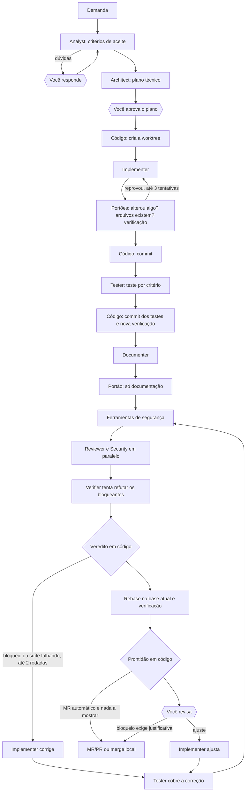
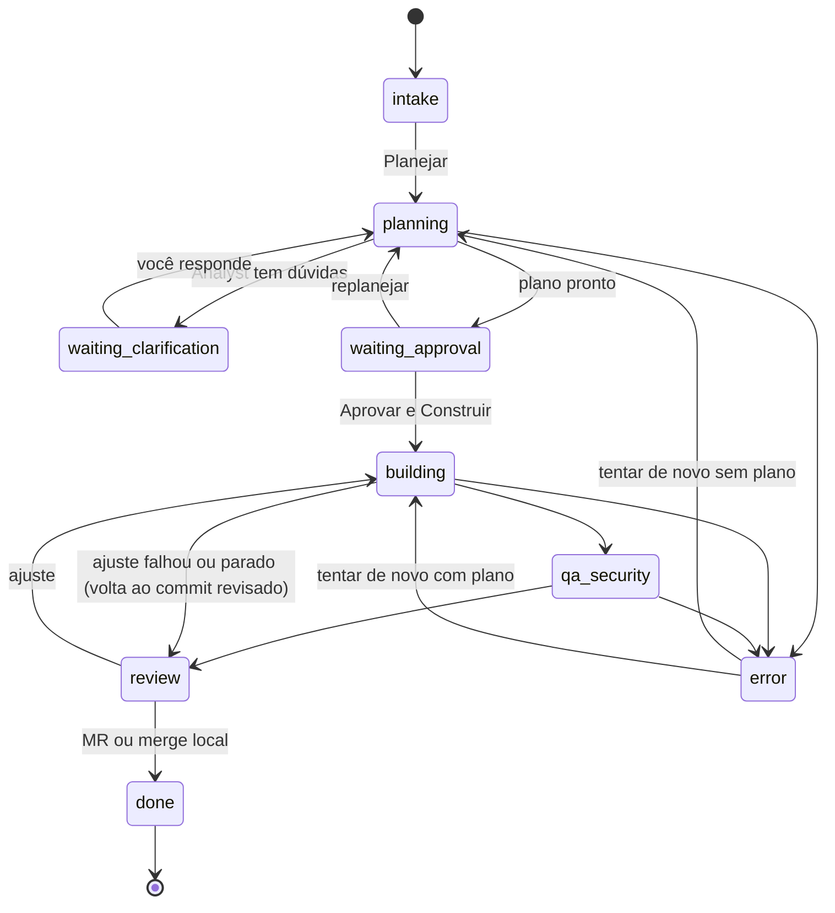
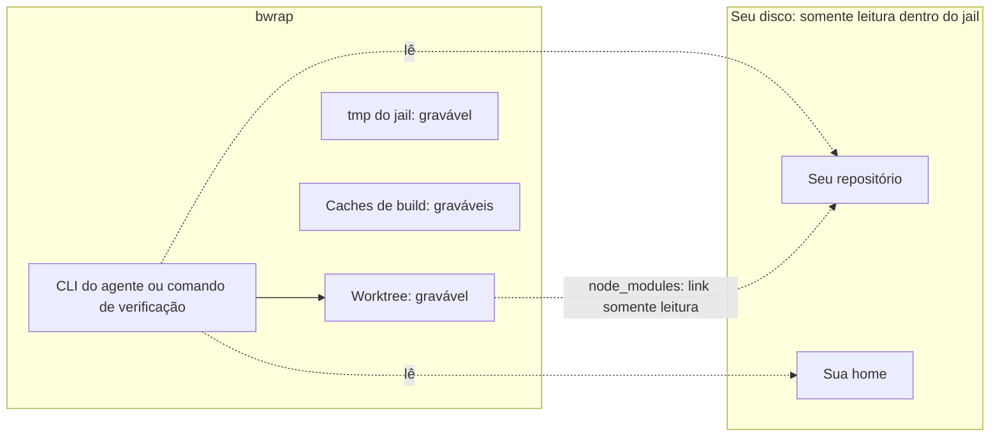

# Fábrica de Software

A Fábrica transforma uma demanda (texto livre ou issue do GitLab/GitHub) em código implementado, testado, revisado e documentado, pronto para virar MR. Oito agentes de IA especializados fazem o trabalho que exige leitura e julgamento; código determinístico faz o resto e decide se cada entrega passa. Tudo acontece numa cópia isolada do repositório, e nada vai para o Git remoto sem a aprovação de uma pessoa.

Este documento descreve como ela funciona por dentro. Para a visão do sistema inteiro, veja [arquitetura.md](arquitetura.md).

## Sumário

1. [Um exemplo do começo ao fim](#1-um-exemplo-do-começo-ao-fim)
2. [Princípios](#2-princípios)
3. [Conceitos](#3-conceitos)
4. [Os oito agentes](#4-os-oito-agentes)
5. [A esteira passo a passo](#5-a-esteira-passo-a-passo)
6. [Estados da tarefa](#6-estados-da-tarefa)
7. [Portões](#7-portões)
8. [Envelopes de handoff](#8-envelopes-de-handoff)
9. [O veredito da revisão](#9-o-veredito-da-revisão)
10. [Segurança e isolamento](#10-segurança-e-isolamento)
11. [Modelos, custo e teto](#11-modelos-custo-e-teto)
12. [Observabilidade: spans, sessão e linha do tempo](#12-observabilidade-spans-sessão-e-linha-do-tempo)
13. [Armazenamento](#13-armazenamento)
14. [API](#14-api)
15. [Interface](#15-interface)
16. [Mapa do código](#16-mapa-do-código)
17. [Testes da própria Fábrica](#17-testes-da-própria-fábrica)
18. [Como estender](#18-como-estender)
19. [Limites conhecidos](#19-limites-conhecidos)
20. [Solução de problemas](#20-solução-de-problemas)
21. [Origem das ideias](#21-origem-das-ideias)

---

## 1. Um exemplo do começo ao fim

Você pede: *"Mover Máquina e Perfil de equipe para o topo da seção Ferramentas"*, no repositório `workStuff`.

1. O **Analyst** lê o menu atual e escreve critérios de aceite ("Dado o menu lateral, quando a seção Ferramentas é exibida, então os itens aparecem nesta ordem: Máquina, Perfil de equipe, Conversores..."). Não encontra dúvida de negócio, então segue.
2. O **Architect** escreve o plano: arquivo `src/app/nav.ts`, mover duas linhas, riscos, cenários de teste.
3. Você lê o plano na gaveta da tarefa, edita se quiser, e clica em **Aprovar e Construir**.
4. A esteira cria uma worktree em `~/.workstuff/worktrees/workStuff/<id>` numa branch `factory/<id>`. O seu checkout não é tocado.
5. O **Implementer** edita `nav.ts`. Os portões conferem que algo mudou, que o arquivo declarado existe e rodam `npm run typecheck` dentro do sandbox. Passou: commit `refactor(nav): ...`.
6. O **Tester** escreve `scripts/check-nav.ts` e diz que ele cobre o critério CA1. A esteira commita o teste, roda a verificação de novo e confere que o arquivo citado existe.
7. O **Documenter** atualiza a documentação afetada e escreve a descrição do MR.
8. As ferramentas de segurança instaladas rodam sobre a branch. **Reviewer** e **Security** revisam o diff em paralelo. Se aparecer um achado grave, o **Verifier** tenta refutá-lo; se ele resiste, o Implementer corrige sozinho, o Tester cobre a correção, até duas rodadas.
9. A branch é rebaseada sobre a base atual e verificada de novo.
10. A tarefa chega em **aguardando revisão**. Você vê o que bloqueia a entrega e o que pede o seu olhar, o diff, o QA, os achados e os critérios, pede ajuste se precisar, e escolhe **Criar MR/PR** ou **Merge Local**. Com "Abrir o MR sozinho" ligado e nada a mostrar, o MR abre sem você.

Durante tudo isso, o cartão da tarefa no Quadro mostra qual agente está trabalhando e em quê; clicar nele abre o trace, com a atividade ao vivo dos agentes e as raias por agente. Clicar numa fase abre um modal com o que ela produziu.

## 2. Princípios

- **O agente propõe, o código decide.** Agentes escrevem e julgam. Comandos previsíveis (git, testes, build) rodam como código, e o veredito é calculado em código, nunca aceito da boca do agente.
- **O humano decide nos pontos que importam.** Três paradas: responder às dúvidas do Analyst, aprovar o plano, aprovar a entrega. A última vira automática quando a tarefa pede e nada bloqueia nem pede atenção.
- **Não verificado não é aprovado.** Sem comando de verificação, com a suíte falhando, com achado bloqueante ou critério não atendido, a entrega só segue com uma justificativa escrita.
- **Isolamento por padrão.** Toda escrita acontece numa worktree; todo agente com escrita e toda execução de código escrito por agente rodam presos no `bwrap`.
- **Contexto passa por contrato.** Cada agente devolve um envelope JSON tipado; o próximo agente recebe o envelope, não a conversa.
- **Falha vira correção, não recomeço.** Portão reprovado devolve ao agente exatamente o que falhou, na mesma sessão quando possível.
- **Tudo é rastreável.** Cada fase vira um span com duração, modelo, custo e chamadas de ferramenta.

## 3. Conceitos

| Termo | O que é |
|---|---|
| **Tarefa** (`FactoryTask`) | Uma demanda e todo o seu histórico: estado, worktree, plano, envelopes, relatórios, spans. Definida em `server/lib/factory/types.ts`. |
| **Worktree** | Cópia de trabalho do repositório (`git worktree`) em `~/.workstuff/worktrees/<repo>/<id>`, na branch `factory/<id>`. O `node_modules`/`.venv` do seu repositório entra como link simbólico, para os testes começarem rápido. |
| **Agente** | Um papel com prompt de sistema próprio e modo `read` ou `write` (`server/lib/factory/agents.ts`). Roda por um CLI de IA: Claude Code, Codex ou Antigravity. |
| **Portão** (*gate*) | Verificação determinística, em código, que aprova ou reprova uma entrega (`server/lib/factory/gates.ts`). |
| **Envelope** | O JSON estruturado que um agente devolve no fim da resposta e que alimenta o passo seguinte (`server/lib/factory/envelopes.ts`). |
| **Span** | Um trecho da linha do tempo: uma execução de agente, um portão ou um passo de código, com início, fim, status, modelo, custo e ferramentas usadas. |
| **Sessão** | O registro, evento a evento, de tudo que os agentes escreveram e das ferramentas que chamaram (`sessions/<id>.jsonl`). |
| **Veredito** | A decisão, em código, se a revisão bloqueia a entrega (`computeVerdict`). |
| **Execução** | Uma ação longa em andamento (planejar, construir, ajustar), registrada em memória com o seu `AbortController` (`server/lib/factory/executions.ts`). |

## 4. Os oito agentes

| Agente | Quando roda | Modo | Onde roda | Entrega (envelope) | Quem confere |
|---|---|---|---|---|---|
| **Analyst** | Início do planejamento | leitura | seu repositório | `SpecEnvelope`: resumo, critérios de aceite, fora do escopo, dúvidas | Você, quando há dúvidas |
| **Architect** | Depois do Analyst, se não houver dúvida | leitura | seu repositório | `PlanEnvelope`: plano em markdown, arquivos-alvo, riscos, cenários de teste | Você, ao aprovar |
| **Implementer** | Construção, correções, ajustes | escrita | worktree, no sandbox | `BuildEnvelope`: arquivos alterados, mensagem de commit, resumo, ou bloqueio | Portões |
| **Tester** | Depois do primeiro commit, de cada rodada de correção e de cada ajuste | escrita | worktree, no sandbox | `TestEnvelope`: testes, arquivo de teste por critério (`criteriaTests`), parecer | Portão de verificação e de cobertura por critério |
| **Documenter** | Antes da revisão, se alguma documentação cita os arquivos alterados | escrita | worktree, no sandbox | `DocsEnvelope`: documentação alterada, descrição final do MR | Portão "só documentação" |
| **Reviewer** | Revisão, em paralelo com Security | leitura | worktree | `ReviewEnvelope`: achados, checagem de cada critério por id, rascunho do MR | Veredito em código |
| **Security** | Revisão, em paralelo com Reviewer, em toda rodada, depois das ferramentas de segurança | leitura | worktree | `ReviewEnvelope`: achados de segurança | Veredito em código |
| **Verifier** | Só quando há achado bloqueante | leitura | worktree | `verdicts`: cada achado se sustenta ou não, com o motivo | Só "não se sustenta" com motivo refuta |

Cada agente recebe o que precisa dos anteriores: os critérios do Analyst chegam ao Architect, ao Implementer, ao Tester e ao Reviewer; os cenários de teste do Architect chegam ao Tester; os achados da rodada anterior chegam aos revisores da rodada seguinte.

**Ferramentas por provedor** (`server/lib/factory/runner.ts`):

| Provedor | Leitura | Escrita |
|---|---|---|
| Claude Code | `--tools Read Grep Glob`, `--strict-mcp-config` | `Read Edit Write Glob Grep Bash` com `--dangerously-skip-permissions`, **sempre dentro do bwrap** |
| Codex | `-s read-only` | `--dangerously-bypass-approvals-and-sandbox`, **sempre dentro do bwrap** (o sandbox do próprio Codex não sobe dentro dele) |
| Antigravity | `--mode plan`, dentro do bwrap sem pasta gravável | `--mode accept-edits`, dentro do bwrap com a worktree gravável |

Os mesmos agentes podem ser chamados avulsos na aba **Agentes Especializados**. Nesse caso rodam sempre em modo leitura, no seu próprio checkout.

## 5. A esteira passo a passo



O código da esteira está em `server/lib/factory/pipeline.ts`. As rotas (`server/routes/factory.ts`) só cuidam de HTTP: validar o estado, abrir o stream e chamar a fase.

### 5.1 Planejamento (`planTask`)

1. A tarefa vai para `planning`.
2. O **Analyst** recebe a demanda (título, descrição, issue, respostas anteriores) e devolve o `SpecEnvelope`.
3. Se houver `openQuestions`, a tarefa para em `waiting_clarification`. Você responde na gaveta; as respostas entram em `task.clarifications` junto com as perguntas, e o planejamento roda de novo do início.
4. Sem dúvidas, o **Architect** recebe a demanda e a especificação e devolve o `PlanEnvelope`. O plano completo que ele escreveu em markdown é guardado em `task.plan`; o campo `plan` do JSON é só um resumo e é descartado de propósito, porque entregar o resumo ao Implementer jogaria o plano real fora.
5. A tarefa vai para `waiting_approval`.

### 5.2 Aprovação e construção (`buildTask`)

1. Você aprova, opcionalmente com o plano editado; a versão editada substitui a do Architect.
2. **Worktree** (código): `createWorktree` cria `factory/<id>` a partir da branch base e liga `node_modules`, `.venv` e `venv` do seu repositório. Uma worktree que sobrou de tentativa anterior é removida antes.
3. **Implementer com laço de correção** (`implementWithGates`):
   - O Implementer recebe a demanda, os critérios, o plano, os arquivos-alvo e os riscos.
   - Se ele devolver `status: "error"`, a execução para com o bloqueio que ele descreveu, em vez de improvisar.
   - Os portões rodam: há alteração, arquivos declarados existem, verificação do projeto.
   - Se um portão reprovar, o Implementer recebe exatamente a falha (até os últimos 8.000 caracteres da saída). Com Claude, a correção continua **a mesma sessão** (`--resume`), então ele não reaprende o repositório; com os outros provedores, a demanda e o plano são repetidos no prompt.
   - Até **3 tentativas**. Esgotadas: diff vazio ou arquivo ausente interrompem a execução; verificação falhando segue para você, com a falha à mostra.
4. **Commit** (código) com a mensagem que o Implementer propôs.

### 5.3 Testes

1. A tarefa vai para `qa_security`.
2. O **Tester** recebe a demanda, os critérios numerados (CA1, CA2...), os cenários de teste do plano e a saída da última verificação. Cada critério precisa de pelo menos um teste que falharia se ele deixasse de valer; no envelope, `criteriaTests` diz qual arquivo cobre cada critério, ou por que um critério não tem comportamento executável (`untestable`).
3. Se ele alterou algo, a esteira commita (`test: cobre "..."`) e roda a verificação de novo. Quem decide se a suíte passa é esse resultado, não o relatório do Tester.
4. No fim da esteira, `checkCriteriaCoverage` confere cada critério contra o disco: `tested` quando todo arquivo citado existe, `untestable` quando o Tester explicou, `missing` quando ele omitiu o critério ou citou um arquivo que não existe. Arquivos que não são de teste alterados pelo Tester ficam registrados em `qaReport.testerTouched`.
5. O Tester roda de novo depois de cada rodada de correção e de cada ajuste, com o aviso de que o código mudou: os testes finais descrevem o código final.

### 5.4 Documentação

1. Antes, a esteira procura documentação versionada que cite pelo caminho algum arquivo alterado (`docsCiting`). Sem nenhuma, o Documenter não roda e a descrição do MR é o rascunho do Reviewer.
2. O **Documenter** recebe a demanda, a especificação, os arquivos alterados e o resumo do Implementer. Ele roda antes da revisão, para a revisão ler o que ele escreveu.
3. O portão "só documentação" descarta qualquer alteração fora de documentação (`.md`, `.mdx`, `.rst`, `.adoc`, `.txt`, `docs/`, `README*`, `CHANGELOG*`, `CONTRIBUTING*`): arquivos rastreados voltam para o último commit e arquivos novos são apagados.
4. Commit `docs: ...` do que sobrou.

### 5.5 Revisão (`reviewAndFix`)

1. **Ferramentas de segurança** (`server/lib/factory/scanners.ts`) rodam no jail sobre a branch, cada uma só quando está instalada e tem o que olhar:
   - `gitleaks detect --log-opts <base>..HEAD`: segredos nos commits da branch. Um achado vira achado `critical` com confiança 100, sem depender do agente.
   - `semgrep scan --config p/default` nos arquivos de código alterados.
   - `npm audit --audit-level=high --omit=dev` quando `package.json` ou `package-lock.json` mudou.
   - Ferramenta ausente aparece como "não instalado", com o caminho de instalação, e pede atenção na entrega. A esteira nunca instala nada.
2. **Reviewer** e **Security** recebem o diff completo contra a base (até 80.000 caracteres; acima disso o prompt avisa que o diff foi cortado) e rodam ao mesmo tempo. O Reviewer recebe também o resultado da última verificação; o Security recebe a saída das ferramentas como evidência. Se um falhar, a esteira espera o outro terminar antes de marcar a falha, para nada continuar escrevendo depois. O Security roda em toda rodada: uma correção pode abrir um buraco como qualquer outra mudança.
3. Os achados são fundidos: o mais grave primeiro, e o mesmo `arquivo:linha` apontado pelos dois fica uma vez só.
4. **Verifier.** Se algum achado bloquearia, o Verifier recebe só esses achados e tenta refutar cada um lendo o código. Um achado deixa de bloquear apenas com `holds: false` e um motivo; achado sem resposta, ou Verifier sem envelope, continua bloqueando. O refutado fica na tela, riscado, com o motivo.
5. O **veredito** é calculado em código ([seção 9](#9-o-veredito-da-revisão)).
6. Com bloqueio, ou com a verificação ainda falhando, o Implementer recebe os achados bloqueantes, os critérios não atendidos e a saída da falha, e corrige passando pelos mesmos portões. Commit `fix: address automatic review findings (round N)`, depois o Tester cobre a correção. Na rodada seguinte, cada revisor recebe só os próprios achados anteriores e confere se foram resolvidos.
7. Até **2 rodadas** automáticas. Depois disso, o que sobrou vai para você.
8. Uma correção que não altera nenhum arquivo encerra as rodadas na hora: revisar o mesmo código de novo só traria os mesmos achados.

### 5.6 Base atual e prontidão

1. **Sincronização** (`syncWithBase`): uma base remota (`origin/main`) é atualizada com `git fetch`, que nunca pede senha (falhou, vale a última base buscada). Se a base andou, a branch é rebaseada sobre ela e a verificação roda de novo; um conflito desfaz o rebase e vira bloqueio. O commit da base verificada fica em `task.verifiedBase`.
2. **Prontidão** (`assessDelivery`, `server/lib/factory/readiness.ts`) é calculada em código a partir dos relatórios e gravada em `task.readiness`:

| Bloqueia a entrega | Pede o seu olhar |
|---|---|
| Nenhum comando de verificação | Critério sem teste automatizado (`missing` ou `untestable`) |
| Verificação falhando ou que não rodou (diz qual etapa) | Achado refutado pelo Verifier |
| Conflito com a base atual | Achado `medium` |
| Achado bloqueante que resistiu ao Verifier | Ferramenta de segurança não instalada ou que não concluiu |
| Critério de aceite não atendido | Tester alterou arquivo que não é de teste |
| Revisão que não rodou ou ficou incompleta | Mais de 400 linhas alteradas |
| | Caminho sensível: CI, Docker, Helm, Terraform, migração, manifesto de dependências, nomes com auth, secret, token, crypt, permission |
| | Alto raio de impacto: arquivo alterado é importado por múltiplos módulos fora do diff sem testes chamadores |

3. **MR automático** (`task.autoMr`): se a tarefa pediu e não há nenhum item em nenhuma das duas colunas, a esteira abre o MR sozinha no fim da construção ou do ajuste. Nunca faz merge local sozinha, porque ele escreve no seu checkout.

### 5.7 Revisão humana

A tarefa chega em `review` com o que bloqueia e o que pede atenção no topo da decisão, o diff com reorganização cognitiva, as estatísticas, o QA (etapas da verificação e teste por critério), os achados, as ferramentas de segurança, a checagem dos critérios e os envelopes. Na gaveta você pode:

- **Revisão cognitiva do diff** (`CognitiveDiffViewer`): os arquivos do diff não são exibidos em bloco único ou ordem alfabética ingênua. São classificados e priorizados pelo fluxo cognitivo de inspeção:
  1. **Lógica central (`core`)**: modelos de domínio, regras de negócio e algoritmos principais;
  2. **Integração & API (`wiring`)**: rotas, controladores, endpoints, schemas e amarrações de pipelines;
  3. **Testes (`tests`)**: suítes unitárias, integração e fixtures de verificação;
  4. **Docs & Metadados (`docs_meta`)**: documentação, manifestos de dependências (`package.json`, `pom.xml`), configs e CI/CD.
  A tela oferece filtros por categoria, busca em tempo real por nome de arquivo, expansão/recolhimento sob demanda e destaca visualmente o **Raio de Impacto (Blast Radius)** ao lado de cada arquivo afetado (indicando se os módulos externos contam ou não com cobertura de testes).
- **Pedir ajuste**: texto livre, ou o botão "Pedir correção" num achado, que preenche o pedido com ele.
- **Abrir no editor**: abre a worktree no VS Code (ou no editor de `WORKSTUFF_EDITOR`).
- **Criar MR/PR**: faz push de `factory/<id>` e abre o MR/PR pela conexão de Repositórios correspondente, com a descrição do Documenter e `Closes #<issue>` quando veio de issue. Se não houver conexão correspondente, a branch fica publicada e a tela avisa para abrir o MR à mão.
- **Entregar com bloqueios**: os botões de MR e merge ficam travados até você escrever por que a entrega segue mesmo assim (pelo menos 10 caracteres). O servidor confere de novo; o motivo e os bloqueios ficam em `task.finishOverride` e entram na descrição do MR, em "Entregue com bloqueios".
- **Base que andou depois da revisão**: ao finalizar, a esteira compara a base com `task.verifiedBase`; se ela andou, faz o rebase e a verificação de novo antes do MR ou do merge, e recalcula os bloqueios.
- **Merge local**: exige o seu repositório sem alterações pendentes, faz checkout da branch base, `merge --no-ff`, e volta para a branch onde você estava. Não faz push.
- **Descartar**: para qualquer execução, remove a worktree e a branch e apaga a tarefa.

Ao concluir (MR ou merge), a worktree é removida; no merge local a branch também.

### 5.8 Ajuste (`adjustTask`)

O pedido de ajuste passa pelo mesmo caminho da construção: Implementer com laço de correção, commit, Tester, revisão com Verifier e rodadas automáticas, sincronização com a base e prontidão. Um ajuste que falha ou é parado volta a worktree ao commit da última revisão (`resetWorktree`) e devolve a tarefa para `review`: a revisão na tela continua valendo para o código que está lá, e um merge não leva commit que ninguém revisou. O ajuste só pode ser pedido a partir de `review`.

### 5.9 Branch base

A branch base padrão é a do `origin/HEAD` do repositório, então costuma ser `origin/main`. A worktree parte dela, mas o MR e o merge local apontam para `main` (`targetBranchOf`).

## 6. Estados da tarefa



| Estado | Rótulo na tela | Significado |
|---|---|---|
| `intake` | na entrada | Criada, nada rodou. |
| `planning` | planejando | Analyst e Architect trabalhando. |
| `waiting_clarification` | aguardando respostas | O Analyst tem dúvidas que só você responde. |
| `waiting_approval` | aguardando aprovação | Plano pronto. |
| `building` | construindo | Implementer na worktree. |
| `qa_security` | QA e segurança | Testes, revisão e documentação. |
| `review` | aguardando revisão | Pronto para você decidir. |
| `done` | concluída | MR aberto ou merge feito. |
| `error` | falhou | A execução falhou; a mensagem fica em `task.error`. |

**Parar uma execução** volta ao último ponto de decisão humana (`stateAfterCancel`): planejamento volta para `intake` (ou para `waiting_approval`, se já havia um plano: um replanejamento parado mantém o plano anterior), construção para `waiting_approval`, ajuste para `review`. Parar encerra também os processos que o agente iniciou (`npm test`, um build): o jail tem o próprio espaço de processos (`--unshare-pid`). Fechar a aba ou o console **não** para nada: só o botão Parar para.

**Servidor reiniciado no meio:** a execução vive na memória do processo. Ao listar as tarefas, uma tarefa num estado de execução sem execução viva é reconciliada (`reconcileTask`): os spans abertos são fechados como falha e ela vai para `error`, com a mensagem de que o servidor reiniciou. A exceção é a tarefa que já tinha passado por uma revisão (um ajuste estava rodando): a worktree volta ao commit dessa revisão (`reviewedHead`) e a tarefa volta para `review`, porque "tentar de novo" a partir de `error` refaria a construção do zero e jogaria fora o trabalho revisado.

**Tentar de novo** a partir de `error`: com plano, reconstrói a worktree do zero e refaz a construção; sem plano, refaz o planejamento.

## 7. Portões

| Portão | O que verifica | Se reprovar |
|---|---|---|
| **Há alterações** | Algum arquivo mudou em relação à base (alterações não commitadas mais o diff da branch), ignorando os links de dependência. | Correção pelo Implementer; esgotado, interrompe. |
| **Arquivos declarados existem** | Cada arquivo do `changedFiles` existe no disco ou está no diff (um arquivo apagado de propósito conta). | Correção; esgotado, interrompe. |
| **Piso de qualidade (sem supressões)** | Rejeita diffs que adicionem supressões de tipo ou linter (`@ts-ignore`, `@ts-nocheck`, `eslint-disable`, `@SuppressWarnings`, `# type: ignore`) ou testes pulados (`.skip()`, `@Disabled`, `@Ignore`). | Correção pelo Implementer; esgotado, interrompe. |
| **Verificação do projeto** | Cada etapa da verificação termina com código 0, dentro do sandbox, parando na primeira que falha. | Correção; esgotado, vai para as rodadas de revisão como bloqueio. |
| **Cobertura por critério** | Cada critério tem um arquivo de teste que existe, ou uma explicação do Tester. | Pede o seu olhar; segura o MR automático. |
| **Ferramentas de segurança** | gitleaks, semgrep e npm audit, quando instalados e aplicáveis. | Segredo vira achado `critical`; o resto é evidência para o Security. |
| **Base atual** | A branch rebaseia sem conflito sobre a base mais nova e passa na verificação de novo. | Conflito bloqueia a entrega. |
| **Documenter só altera documentação** | Nenhum arquivo fora de documentação mudou. | Descarta as alterações fora de documentação e segue. |

**Comando de verificação.** O da tarefa (`verifyCommand`) substitui os detectados; sem ele, `detectVerifyCommands` junta todas as etapas que o projeto tem, e cada uma roda separada:

| Arquivo no repositório | Etapas |
|---|---|
| `package.json` | `npm run lint`, `npm run typecheck`, `npm test` (se for real), `npm run check`, `npm run build`, nesta ordem, as que existirem |
| `pom.xml` | `mvn -q verify` (testes e os plugins ligados ao build) |
| `gradlew` | `./gradlew build` (inclui `check`) |
| `pytest.ini` ou `pyproject.toml` | `pytest` |
| `go.mod` | `go vet ./...`, `go test ./...` |

O **comando de smoke** da tarefa (`smokeCommand`) roda por último, no mesmo jail: subir a aplicação, chamá-la e derrubá-la. O jail tem o próprio espaço de processos, então o que ficar rodando morre junto.

Sem nenhum comando, nada é verificado: o QA fica reprovado e a entrega bloqueada. Limite de 10 minutos por etapa; a saída guardada é a cauda (últimos 30.000 caracteres), que é onde a falha aparece.

## 8. Envelopes de handoff

Cada agente termina a resposta com um bloco ```` ```json ```` no formato pedido. A esteira usa o **último** bloco JSON válido, porque o texto antes dele pode trazer seus próprios exemplos de código. Campos ausentes ou inválidos recebem valores seguros (por exemplo, uma severidade desconhecida vira `low`), e um agente que não devolve envelope não derruba a esteira: o texto livre vira o conteúdo.

```jsonc
// Analyst -> SpecEnvelope
{ "status": "ok", "summary": "...", "acceptanceCriteria": ["Dado ..., quando ..., então ..."],
  "outOfScope": ["..."], "openQuestions": [] }

// Architect -> PlanEnvelope (o markdown completo vira task.plan)
{ "status": "ok", "plan": "resumo", "targetFiles": ["src/a.ts"], "risks": ["..."], "testScenarios": ["..."] }

// Implementer -> BuildEnvelope ("error" = bloqueio declarado)
{ "status": "ok", "changedFiles": ["src/a.ts"], "commitMessage": "feat: ...", "summary": "..." }

// Tester -> TestEnvelope
{ "status": "ok", "testSuitePassed": true, "testsRan": ["..."],
  "criteriaTests": [{ "id": "CA1", "tests": ["src/a.test.ts"] }, { "id": "CA2", "tests": [], "untestable": "texto de ajuda" }],
  "coverageNotes": "...", "details": "..." }

// Reviewer e Security -> ReviewEnvelope
{ "status": "ok",
  "findings": [{ "severity": "high", "confidence": 85, "file": "src/a.ts", "line": 42, "description": "..." }],
  "criteria": [{ "id": "CA1", "criterion": "...", "met": true, "evidence": "src/a.ts:42" }],
  "mrDescription": "...", "summary": "..." }

// Verifier -> verdicts (um por achado, pelo número no prompt)
{ "verdicts": [{ "index": 1, "holds": false, "reason": "a entrada já é validada em src/a.ts:10" }] }

// Documenter -> DocsEnvelope
{ "status": "ok", "changedFiles": ["README.md"], "mrDescription": "..." }
```

Os tipos ficam em `server/lib/factory/types.ts`, os parsers e os formatadores de prompt em `server/lib/factory/envelopes.ts`.

## 9. O veredito da revisão

```
bloqueia se houver
  achado não refutado com severidade high ou critical E confiança >= 75   (sem confiança informada conta como 75)
  OU critério de aceite marcado como não atendido
```

Todo achado começa pela falha concreta: a entrada, o estado ou a sequência que faz o código errar. Código que "poderia" falhar sem um caminho que chegue lá não é high nem critical; em arquivo de teste, só conta um teste quebrado.

A régua de severidade é avaliada por consequência real e não por regra quebrada:

| Severidade | Quando |
|---|---|
| `critical` | Comportamento errado, perda de dado, segredo exposto, contrato quebrado, regressão demonstrável. |
| `high` | Vulnerabilidade ou bug provável num caminho de produção, ainda sem prova completa. |
| `medium` | Risco não demonstrado, ou caminho novo de produção sem teste. |
| `low` | Estilo, legibilidade, preferência. |

Cada revisor lista no máximo 12 achados, do mais grave ao menos grave, e é instruído a não decidir a aprovação.

**Revisão incompleta bloqueia** (`incompleteReview`). Antes do veredito, a esteira confere se a revisão aconteceu de fato:

- Reviewer ou Security sem envelope JSON, ou com `status: "error"`;
- Reviewer que não devolveu algum id de critério da especificação (CA1, CA2...). O id, não o texto: revisores reescrevem os critérios, e trocar um critério por outro inventado não passa.

Em qualquer desses casos a revisão não passa e não há rodada automática, porque o Implementer não tem o que corrigir: a tarefa vai para você com um achado `high` explicando o motivo.

## 10. Segurança e isolamento



- **Worktree, nunca o seu checkout.** Toda escrita da Fábrica acontece em `~/.workstuff/worktrees`. O seu repositório só muda no merge local, que você pede.
- **Jail `bwrap`.** O disco inteiro é montado somente leitura (`--ro-bind / /`). Ficam graváveis apenas as pastas necessárias:
  - Agentes Claude e Codex com escrita: a worktree, um tmp e uma pasta de configuração própria ao lado da worktree (`<worktree>.agent-home/claude` via `CLAUDE_CONFIG_DIR`, `<worktree>.agent-home/codex` via `CODEX_HOME`), nunca o `~/.claude` ou o `~/.codex` reais: um hook, servidor MCP ou arquivo de instrução plantado ali rodaria fora do jail na execução seguinte. Do Claude entra só o token de acesso, sem o refresh token, para uma renovação dentro do jail não deslogar o seu CLI; do Codex, `auth.json` e `config.toml`. A pasta persiste entre as execuções da tarefa (o `--resume` depende dela) e é apagada com a worktree.
  - Antigravity: a worktree (só em escrita), `~/.gemini` e um tmp. O Antigravity grava em disco mesmo em modo plano, então nunca roda fora do jail.
  - Verificação do projeto: a worktree, um tmp e só as pastas de cache do Maven e do Gradle (`~/.m2/repository`, `~/.m2/wrapper`, as subpastas de `~/.gradle` menos `init.d`). `settings.xml`, `init.d` e `gradle.properties` ficam somente leitura, porque executam código no seu próximo build. npm, Go e pip usam um cache descartável no tmp do jail.
- **`.git` da worktree somente leitura.** O arquivo `.git` diz ao git onde está o repositório, e a esteira roda git na worktree fora do jail; ele é montado somente leitura em todo jail.
- **Hooks do git desligados.** Todo git da esteira roda com `core.hooksPath=/dev/null`: um hook do repositório (husky, lint-staged) leria scripts e configurações da worktree, que o agente escreveu.
- **Verificação no jail.** A suíte de testes executa código que o agente escreveu. Rodar fora do jail anularia o isolamento do agente, então sem `bwrap` a verificação não roda e o QA aparece reprovado.
- **`.git` somente leitura para os agentes.** Os commits são feitos pela esteira, em código.
- **Nada vai ao remoto sem você.** O push só acontece em "Criar MR/PR".
- **Validação na fronteira.** Provedor, modelo, modelos por agente, teto e branch base são validados ao criar ou editar a tarefa, porque viram argumentos de linha de comando.
- **Só o localhost chama a API.** Uma requisição cujo `Host` ou `Origin` não seja `localhost`, `127.0.0.1` ou `[::1]` recebe 403 (`server/lib/localOrigin.ts`): sem isso, uma página aberta no navegador dispararia ações da Fábrica.
- **Processos sem shell**, com uma exceção: os comandos de verificação e de smoke rodam como `sh -c`, dentro do jail, porque são seus.
- **Ferramentas de segurança no jail.** gitleaks, semgrep e npm audit leem código que o agente escreveu, então rodam no mesmo jail da verificação, com uma `HOME` descartável. Só rodam se você as instalou.
- **`git fetch` sem pergunta.** A atualização da base roda com `core.askPass=true` e `ssh -o BatchMode=yes`: precisando de senha, falha e a última base buscada vale.

## 11. Modelos, custo e teto

- **Custo e tokens** de cada execução de agente vêm da linha final do CLI (Claude informa tokens e custo em US$; Codex informa tokens; Antigravity não informa nada). Ficam em `span.usage` e são somados na tarefa (`taskUsage`).
- **Modelo por agente** (`task.agentModels`) substitui o modelo da tarefa para um agente. O atalho "opus para julgar, sonnet para construir" usa opus em Analyst, Architect, Reviewer, Security e Verifier e sonnet em Implementer, Tester e Documenter. Cada span registra o modelo com que rodou.
- **Teto de custo** (`task.budgetUsd`) é conferido **antes** de cada agente, somando o custo de todos os spans da tarefa, inclusive tentativas anteriores. Atingido, a execução para com erro e você aumenta o teto na gaveta.
  - O custo só chega quando uma execução termina, então a última pode passar do teto.
  - Provedor que não informa custo nunca é barrado.

## 12. Observabilidade: spans, sessão e linha do tempo

- **Spans** (`task.spans`): um por agente, portão ou passo de código, com `kind` (`agent`, `gate`, `code`), status, duração, modelo, custo, envelope, detalhes (comando e saída do portão) e as chamadas de ferramenta. Cada chamada de ferramenta é ligada ao span do agente que a fez, o que importa quando Reviewer e Security rodam juntos.
- **Sessão** (`sessions/<id>.jsonl`): uma linha por evento (texto, raciocínio, ferramenta, resultado de ferramenta, status), com data e o agente que o produziu. Trechos de texto seguidos do mesmo agente são juntados na leitura.
- **Acompanhamento ao vivo**: `GET /api/factory/tasks/:id/events` é um stream SSE que manda primeiro tudo o que já foi gravado e depois cada evento novo. Ler e assinar acontecem no mesmo instante, então nada se perde nem se duplica. O navegador reconecta sozinho. O estado da tarefa (spans e relatórios) é consultado a cada 1,5 s enquanto ela roda.
- **A execução não depende da tela.** Fechar o console, a gaveta ou a aba só para de assistir.

## 13. Armazenamento

Tudo fica fora do repositório, em `WORKSTUFF_HOME` (padrão `~/.workstuff`):

| Caminho | Conteúdo |
|---|---|
| `factory/tasks.json` | Todas as tarefas. A gravação usa um arquivo temporário e `rename`, então uma queda no meio não deixa o arquivo pela metade. |
| `factory/sessions/<id>.jsonl` | A sessão de cada tarefa, evento por evento (`.json` é o formato antigo, ainda lido). |
| `worktrees/<repo>/<id>/` | As worktrees em andamento. |

## 14. API

Prefixo `/api/factory`, em `server/routes/factory.ts`. As ações longas respondem como stream SSE.

| Método e caminho | O que faz |
|---|---|
| `GET /tasks` | Lista as tarefas, já reconciliadas (estado de execução sem execução viva vira `error`). |
| `POST /tasks` | Cria uma tarefa: título, descrição, repositório, base, provedor, modelo, modelos por agente, teto, comando de verificação, comando de smoke, MR automático (`autoMr`), issue de origem. |
| `GET /tasks/:id` | Uma tarefa. |
| `PATCH /tasks/:id` | Edita título, descrição, provedor, modelo, modelos por agente, teto, comando de verificação. |
| `DELETE /tasks/:id` | Para a execução, remove worktree e branch, apaga a tarefa e a sessão. Responde 409 se a execução não parar em 5 s, para ela não regravar a tarefa apagada. |
| `GET /tasks/:id/session` | A sessão completa. |
| `GET /tasks/:id/events` | Stream SSE da sessão: tudo o que já foi gravado, depois o que for chegando. |
| `POST /tasks/:id/plan` | Planejamento (SSE). Aceita `answers` às dúvidas do Analyst. |
| `POST /tasks/:id/approve-plan` | Construção completa (SSE). Aceita `plan` editado. |
| `POST /tasks/:id/adjust` | Ajuste com `feedback` (SSE). |
| `POST /tasks/:id/cancel` | Para a execução em andamento. |
| `GET /tasks/:id/diff` | Diff e estatísticas da worktree. |
| `POST /tasks/:id/open-editor` | Abre a worktree no editor. |
| `POST /tasks/:id/finish` | `mode: "mr"` (push e MR/PR) ou `"local_merge"`; outro valor responde 400. Se a base andou, rebase e verificação antes. Com bloqueios, exige `override` (o motivo, 10 caracteres ou mais) e senão responde 409 com `blockers`. Registrado como execução: um segundo clique recebe 409 em vez de fazer um segundo merge. |
| `POST /agents/run` | Executa um agente avulso, em modo leitura (SSE). |
| `GET /preflight` | Para o modo guiado: `bwrap`, CLIs instalados, configurações e, com `repoPath`, branch, base, pendências e comando de verificação detectado. |
| `GET /issues` | Issues abertas das conexões de Repositórios (até 30 por conexão). |
| `POST /pick-folder` | Seletor de pasta nativo. |
| `GET /settings` | Provedor, modelo e esforço de Configurações. |

Uma ação pedida num estado que não a permite (botão velho, clique duplo) responde 409, assim como iniciar uma execução numa tarefa que já tem outra rodando.

## 15. Interface

Tudo em `src/features/factory/`.

| Tela ou peça | Arquivo | O que mostra |
|---|---|---|
| Página | `FactoryPage.tsx` | Abas Quadro e Agentes Especializados; contadores (em andamento, aguardando você, concluídas); botões Modo guiado e Nova Tarefa. |
| Quadro Kanban | `FactoryBoard.tsx` | Colunas por fase. Cada cartão mostra o andamento de cada agente, a etapa de agora (quem, qual, há quanto tempo, quantas ferramentas), o custo e as ações do estado. Clicar abre o trace. |
| Ações por estado | `TaskActions.tsx`, `nextActions` em `factoryRun.ts` | A única regra de "o que fazer agora" em cada estado, usada pelo cartão e pelo trace. Aprovar o plano e responder dúvidas sempre abrem a gaveta, que mostra o que está sendo aprovado. |
| Trace da tarefa | `timeline/FactoryTraceVisualizer.tsx` | A atividade dos agentes ao vivo (`ActivityFeed.tsx`: o que cada agente escreve e cada ferramenta que chama, com a saída) e, abaixo, as raias por ator posicionadas no tempo. |
| Detalhe da fase | `timeline/PhaseDetailModal.tsx` | Modal ao clicar num bloco: o resultado daquela fase, a saída do agente ao vivo e cada ferramenta chamada. |
| Gaveta da tarefa | `TaskReviewDrawer.tsx` | Dúvidas do Analyst, critérios e plano (editável), diff, QA, revisão e segurança, ajuste, MR ou merge, descarte (com `ConfirmModal`). |
| Nova tarefa | `NewTaskModal.tsx` | Criação direta: manual ou por issue, com todas as opções; avisa quando falta o `bwrap`. |
| Modo guiado | `FactoryWizard.tsx` | Seis passos: como funciona, pré-requisitos, repositório, demanda, agentes e custo, revisar. Abre sozinho na primeira visita sem tarefas. |
| Agentes avulsos | `StandaloneAgentTab.tsx` | Um agente, um prompt, um repositório, em modo leitura, com runbooks relacionados. |
| Estado compartilhado | `factoryRun.ts` | Rótulos de estado, cores e nomes dos agentes, ações por estado (`nextActions`), início de ações, acompanhamento ao vivo (`useLiveTask`), custo. |

## 16. Mapa do código

| Arquivo | Responsabilidade |
|---|---|
| `server/lib/factory/types.ts` | Tipos e constantes compartilhados com a interface: estados, agentes e ordem (`AGENT_ORDER`), envelopes, spans, `taskUsage`. Sem import de `node:`, para o frontend poder importar. |
| `server/lib/factory/agents.ts` | Os oito agentes: papel, modo e prompt de sistema, com a régua de achados compartilhada pelos revisores. |
| `server/lib/factory/pipeline.ts` | A esteira: `planTask`, `buildTask`, `adjustTask`, o laço de correção, a revisão em dupla, o Documenter, o teto de custo. |
| `server/lib/factory/envelopes.ts` | Prompts de cada passo, leitura dos envelopes, `computeVerdict`, `mergeFindings`. |
| `server/lib/factory/gates.ts` | Portões, detecção das etapas de verificação, execução no jail (`runJailed`), cobertura por critério. |
| `server/lib/factory/scanners.ts` | gitleaks, semgrep e npm audit no jail; segredo encontrado vira achado. |
| `server/lib/factory/readiness.ts` | `assessDelivery`: o que bloqueia e o que pede atenção; `canAutoMr`. |
| `server/lib/factory/runner.ts` | Argumentos de cada CLI por modo, jail `bwrap` (`jail`, `withSandbox`), `--resume`. |
| `server/lib/factory/worktree.ts` | Criar, commitar, comparar, descartar arquivos, rebasear sobre a base (`syncWithBase`), publicar, mesclar e remover worktrees. |
| `server/lib/factory/store.ts` | `tasks.json`, spans, chamadas de ferramenta e a sessão JSONL com assinantes ao vivo. |
| `server/lib/factory/executions.ts` | Registro em memória das execuções, cancelamento, estado de retorno após parada. |
| `server/routes/factory.ts` | Rotas HTTP, guardas de estado, validação de entrada, streams SSE, MR/PR. |
| `server/lib/ai/runner.ts`, `events.ts` | Execução dos CLIs com watchdog (15 min de limite e 4 min sem saída na Fábrica) e normalização dos eventos e do custo. Compartilhados com o resto do painel. |

## 17. Testes da própria Fábrica

Todos entram no `npm run check`:

| Teste | Cobre |
|---|---|
| `node server/lib/factory/store.ts --selfcheck` | Tarefas, spans, ferramentas, sessão, assinantes. |
| `node server/lib/factory/worktree.ts --selfcheck` | Worktree, link de dependências fora do commit (com `.gitignore` com e sem barra), descarte seletivo, rebase sobre base que andou e conflito desfeito, merge com repositório sujo. |
| `node server/lib/factory/agents.ts --selfcheck` | Todo agente da ordem tem definição; modos de leitura e escrita. |
| `node server/lib/factory/runner.ts --selfcheck` | Argumentos por provedor e modo; escrita só no jail; `--resume`. |
| `node server/lib/factory/gates.ts --selfcheck` | Portões, detecção das etapas, etapas em sequência com smoke por último, "nada para rodar" reprova, jail de verdade (escrita fora da worktree barrada), cobertura por critério. |
| `node server/lib/factory/scanners.ts --selfcheck` | Ferramenta ausente sugerida e não instalada, códigos de saída, segredo vira achado. |
| `node server/lib/factory/readiness.ts --selfcheck` | Cada bloqueio e cada ponto de atenção; MR automático só com tudo limpo. |
| `node server/lib/factory/envelopes.ts --selfcheck` | Leitura dos envelopes, veredito, refutação do Verifier, critérios por id, fusão de achados, conteúdo dos prompts. |
| `node server/lib/factory/executions.ts --selfcheck` | Registro, cancelamento, limpeza atrasada. |
| `node scripts/check-factory-pipeline.ts` | A esteira inteira, com um `claude` falso no `PATH`: dúvida do Analyst, correção após portão, achado bloqueante corrigido na rodada automática, achado refutado pelo Verifier, Tester depois da correção, Documenter barrado, sem verificação bloqueia, rebase quando a base anda, modelo por agente, teto de custo. Não gasta tokens. |

## 18. Como estender

**Um agente novo**

1. Acrescente o id em `SpecializedAgentId` e na posição certa de `AGENT_ORDER` (`types.ts`).
2. Defina papel, modo e prompt em `agents.ts`.
3. Dê nome, papel e cor em `AGENT_UI` (`factoryRun.ts`), a variável `--fx-<id>` nos dois temas de `factory.css` e um ícone em `AGENT_ICON` (`FactoryTraceVisualizer.tsx`). As raias e as listas leem dessas tabelas.
4. Escreva o envelope e o formatador de prompt em `envelopes.ts` e chame o agente com `agentStep` no ponto certo de `pipeline.ts`.
5. Se ele aparece no modal de fase, acrescente o caso em `PhaseResult` (`PhaseDetailModal.tsx`).
6. Ensine o `claude` falso de `scripts/check-factory-pipeline.ts` a responder por ele.

O selfcheck de `agents.ts` falha se um agente da ordem ficar sem definição, e o typecheck falha se `AGENT_UI` ou `AGENT_ICON` ficarem incompletos.

**Um portão novo**: escreva a função em `gates.ts` e chame com `codeStep(ctx, 'gate', ...)` em `pipeline.ts`. Código escrito pelo agente executa sempre via `withSandbox` e `jail`.

## 19. Limites conhecidos

- **Execuções vivem na memória**: reiniciar o servidor no meio de uma execução a interrompe (a tarefa vai para `error` e pode ser retomada).
- **Cache dentro de `node_modules`**: o `node_modules` é um link somente leitura para o seu repositório, então uma ferramenta que grava cache dentro dele (como o vitest) falha na verificação. Configure o comando da tarefa para contornar.
- **Teto de custo**: conferido entre execuções, não no meio; sem efeito para provedores que não informam custo.
- **Revisão de rodada 2 em diante** recebe o diff completo, não só o que mudou desde a rodada anterior.
- **O Verifier só lê.** Ele refuta lendo o código, não executando; rodar um caso que prove a falha pediria uma worktree descartável.
- **Cobertura por critério confere o arquivo, não o teste.** A esteira sabe que o arquivo citado existe e que a suíte passou, não que aquele teste exercita o critério; isso continua com o Reviewer.
- **Caminhos sensíveis por nome**: `auth` também pega `author`. Falso positivo só segura o MR automático.
- **Nova verificação no finish** acontece dentro da requisição: se a base andou, o clique em MR ou merge pode levar minutos.
- **Ferramentas de segurança** dependem do que está instalado; `semgrep --config p/default` e `npm audit` precisam de rede.
- **`tasks.json` é reescrito a cada evento de span**: suficiente para um usuário; com muitas tarefas paralelas, trocar por banco.
- **MR/PR** depende de uma conexão em Repositórios com o mesmo host do `origin` do projeto e cujo grupo base contenha o projeto (`sourceForRemote`).
- **`bwrap` só existe no Linux**: no macOS e no Windows, agentes com escrita e Antigravity não rodam, e a verificação não executa.
- **O que o jail ainda não fecha**: a rede fica aberta e a home fica legível (um agente manipulado pode ler um token e enviá-lo); um jar dos caches compartilhados do Maven e do Gradle pode ser trocado; o Antigravity grava no `~/.gemini` real.

## 20. Solução de problemas

| Sintoma | Causa provável | O que fazer |
|---|---|---|
| Falha no commit com `paths are ignored ... node_modules` | Versão antiga do servidor (corrigido em `0b7f7d0`): com `node_modules` sem barra no `.gitignore`, o link era recusado. | Reinicie o `npm run dev` se ele não recarregou sozinho e use "Tentar novamente". |
| A correção foi enviada, mas o erro continua igual | O `node --watch` não reiniciou o servidor. | Pare o `npm run dev` com Ctrl+C e suba de novo. |
| QA reprovado com "bwrap (bubblewrap) não está instalado" | Sem `bwrap`, a verificação não roda fora do sandbox. | Instale o pacote `bubblewrap` (a tela Máquina mostra o comando). |
| "o agente com escrita só roda dentro do bwrap" / "o Codex com escrita só roda dentro do bwrap" | Agente com escrita sem `bwrap`. | Instale o `bubblewrap` (a tela Máquina mostra o comando). |
| Entrega bloqueada com "Nada foi verificado" | Nenhum comando detectado. | Informe o comando de verificação da tarefa, ou escreva por que entrega sem ele. |
| "gitleaks não está instalado" pedindo atenção | Ferramenta ausente na máquina. | Instale pelo caminho indicado; sem ela, o MR automático não abre. |
| "Teto de custo atingido" | O gasto somado chegou ao teto. | Aumente o teto na gaveta e tente de novo. |
| Tarefa em "falhou" com "o servidor foi reiniciado" | O servidor caiu ou recarregou no meio da execução. | "Tentar novamente". |
| "Falha de autenticação do provedor" | Sessão do CLI expirada. | `claude login` ou `codex login` no terminal, ou troque o provedor na gaveta. |
| MR não abriu, mas a branch foi publicada | Nenhuma conexão de Repositórios corresponde, ou o servidor recusou. | Abra o MR à mão; a mensagem traz o motivo. |
| Merge local recusado | O seu repositório tem alterações pendentes. | Faça commit ou stash e tente de novo. |

Os [runbooks de dev da Fábrica](../dev-runbooks/factory/) cobrem os procedimentos manuais: limpar worktrees, reproduzir um portão, publicar a branch, resolver um merge local que falhou.

## 21. Origem das ideias

| Ideia | De onde veio |
|---|---|
| Fases de código e de agente; "o agente propõe, o código decide" | [super-simple-software-factory](https://github.com/disler/super-simple-software-factory) |
| Envelopes tipados entre agentes; portões que verificam o que o agente declarou | super-simple-software-factory |
| Correção na mesma sessão em vez de recomeçar | super-simple-software-factory |
| Documenter; modelo caro para planejar e barato para construir | super-simple-software-factory |
| Trace em raias por agente | super-simple-software-factory |
| Especificação com critérios de aceite antes do plano; dúvidas que param a esteira | projeto de referência (triage e concept) |
| Revisão em paralelo por especialistas; severidade por consequência; confiança mínima de 75; veredito em código | projeto de referência (review squad) |
| Achado começa pela falha concreta; teste só conta se a asserção pode falhar; "não audite o arquivo inteiro" | projeto de referência (`REVIEW_FINDING_BAR`) |
| Critério por id conferido contra a especificação; teste que prova comportamento | projeto de referência (sdd-compliance-reviewer e test-reviewer) |
| Verifier adversarial, ferramentas de segurança, prontidão em código e MR automático | workStuff |
| Até 3 tentativas de build e 2 rodadas automáticas de revisão | projeto de referência (`max_dev_retries`, `max_auto_rounds`) |
| Worktree isolada, sandbox `bwrap`, aprovação local antes do MR | workStuff |
| Piso de qualidade determinístico (sem `@ts-ignore` / `.skip()`) e regras anti-slop | [pstack / unslop](referencias-skills.md#31-portão-de-piso-de-qualidade--prompts-anti-slop) (Addy Osmani / Cursor plugins) |
| Cálculo de raio de impacto (blast radius) via `git grep` e bloqueio na prontidão | [blast-radius](referencias-skills.md#32-raio-de-impacto-blast-radius--prontidão-de-entrega) (Lauren Tan / Cursor plugin) |
| Reorganização cognitiva do diff em 4 camadas e review canvas na gaveta | [pr-review-canvas](referencias-skills.md#33-reorganização-cognitiva-do-diff--review-canvas) (Lauren Tan / Cursor plugin) |

A análise comparativa aprofundada de todas as skills e o que foi aproveitado ou rejeitado está detalhada em [`docs/referencias-skills.md`](referencias-skills.md).
O histórico das decisões está em [`superpowers/specs/2026-10-04-fabrica-dev-design.md`](superpowers/specs/2026-10-04-fabrica-dev-design.md).
